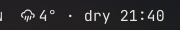
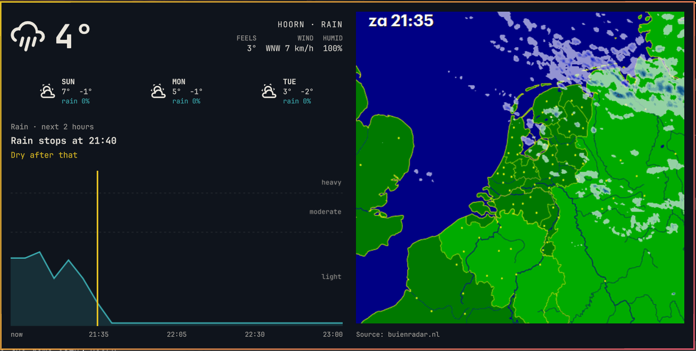
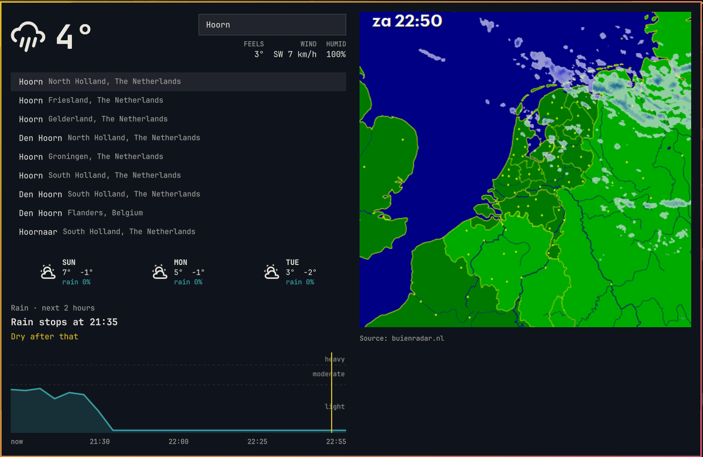

# Buienradar Rain for Omarchy

An [Omarchy](https://omarchy.org/) bar widget for weather and rain. It can replace the standard `omarchy.weather` widget.
Data comes from [Buienradar](https://www.buienradar.nl), so it works in the Netherlands and Belgium only.





- **Bar:** condition icon, temperature and the next rain change, for example `4° · dry 21:40`.
- **Popup, left:** weather now (feels like, wind, humidity), the next 3 days with rain chance, a rain summary, and a 2-hour rain graph with light/moderate/heavy levels.
- **Popup, right:** the animated Buienradar radar map for the same 2 hours. The yellow line on the graph shows the time of the map frame on screen.
- **Place:** click the place name in the popup, type, and pick a suggestion.



- **Mouse:** left click opens the popup. Middle click refreshes.

## Install

```bash
omarchy plugin add https://github.com/neotyk/omarchy-buienradar-rain --enable
```

Then open the popup, click **SET LOCATION**, and search for your place.
Without a location, the widget uses Amsterdam.

To drop the standard weather widget, remove `omarchy.weather` from the bar in
`~/.config/omarchy/shell.json`.

## Remove

```bash
omarchy plugin remove io.github.neotyk.buienradar-rain
```

## Dependencies

- `curl` (installed on Omarchy by default).
- A Nerd Font for the weather icons (Omarchy's default font includes them).
- Network access to:
  - `gpsgadget.buienradar.nl` – 2-hour rain forecast
  - `data.buienradar.nl` – current weather and forecast
  - `image.buienradar.nl` – radar animation, saved to `$XDG_RUNTIME_DIR/buienradar-radar.gif`
  - `geocoding-api.open-meteo.com` – place search, only while you type a place

## Test

```bash
node test.js
```

## License

MIT, see [LICENSE](LICENSE).

Rain data and radar images © Buienradar / RTL, used under the
[Buienradar feed terms](https://www.buienradar.nl), which require a credit to buienradar.nl.
